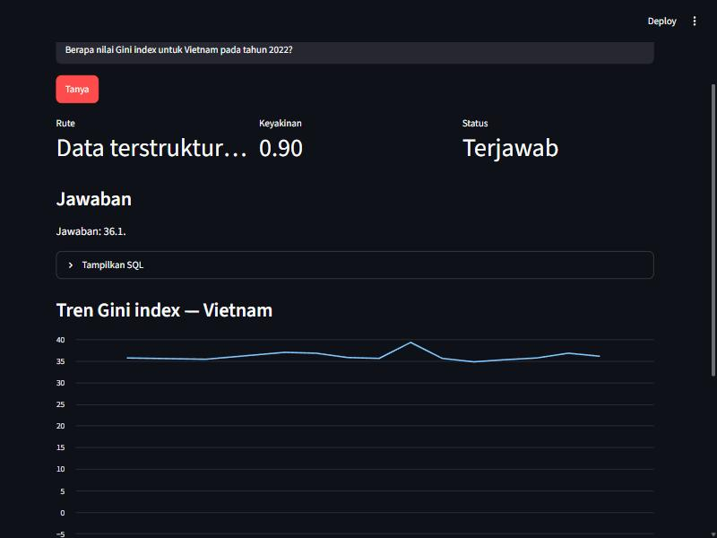
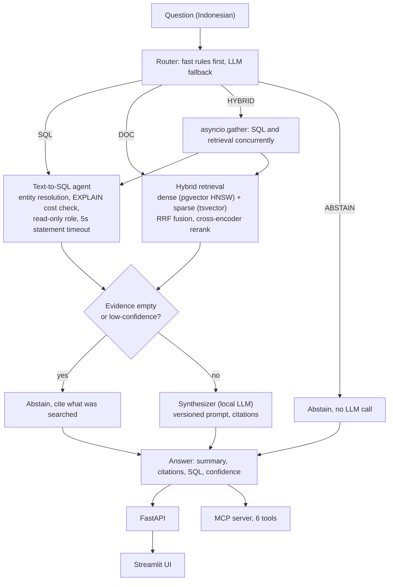

# NusaLens

Ask a question about Indonesia in Indonesian; get an answer grounded in World Bank indicators and indexed Wikipedia articles, with citations, SQL shown, and an honest "I don't know" when the evidence isn't there.



More screenshots: [DOC route with citations](reports/figures/11_ui_doc.png), [ABSTAIN route](reports/figures/11_ui_abstain.png).

## Problem

Public data about Indonesia is split across a structured numeric source (World Bank indicators) and unstructured document text (Wikipedia articles), and answering a real question often needs both at once ("summarize X, then give me the latest figure for Y"). A single LLM asked to answer directly, with no retrieval or SQL execution, has no way to get either of these right: it has no access to the numbers, and it will not reliably say "I don't know" instead of inventing a plausible-sounding one.

## Solution

A fast rule-based router (falls back to a local LLM only for phrasing it cannot classify by pattern) sends each question to text-to-SQL, hybrid document retrieval, or both concurrently; a local LLM synthesizes an answer from the returned evidence, and the response carries the source chunks, SQL, and confidence separately. An abstain gate blocks a response when the evidence is empty or low-confidence rather than letting the model guess. Every component runs locally: Postgres with pgvector, Ollama for generation, and a fine-tuned local embedding model, no paid API calls anywhere in the pipeline.

## Measured results

Every number below traces to a report file; see `reports/14_portfolio.md` for the full traceability table.

| Metric | Result | Source |
|---|---|---|
| Retrieval gain, production config (`rrf_rerank_exp`, stock embedding) | nDCG@10 0.390 (dense only) to 0.630 (full pipeline), +61.5% | `reports/05_hybrid_search.md` |
| Retrieval gain, fine-tuned embedding measured (not yet deployed) | nDCG@10 0.646, +65.6% over the dense baseline | `reports/06_finetune_embedding.md` |
| Text-to-SQL execution accuracy | 100% (35/35), reconfirmed on the full 120-item end-to-end run | `reports/07_text2sql.md`, `reports/09_e2e.md` |
| Routing accuracy, full pipeline | 99.2% (119/120) | `reports/09_e2e.md` |
| Abstain recall (the safety-critical metric) | 100% (15/15) | `reports/09_e2e.md` |
| Groundedness on answered items | 68.6% (`fact_coverage`) / 40.6% (LLM judge), against an 80% target, root cause identified | `reports/09_e2e.md` |
| Follow-up synthesizer prompt trial | v4 evidence-verification instruction: 57.1% fact coverage, unchanged from v1; abstain recall remains 0% | `reports/raw/08_synth_eval_v4.json` |
| Follow-up judge trial | v5 two-call evidence analysis then boolean decision: 55% agreement, below v3's 60% | `reports/raw/08_judge_calibration_v5.json` |
| End-to-end latency, p95 | 44.5 s overall; 4.0 s for SQL-only, 36 ms for a correctly abstained question | `reports/09_e2e.md` |
| Test coverage | 70% on `src/nusalens/`, 98 tests passing | `reports/raw/13_coverage.txt` |
| Full pipeline reproducibility | 1980 s (33 min) from `setup` through `test` | `reports/13_quality.md` |

Groundedness is the one target not met, and that is reported here rather than hidden: the synthesizer sometimes denies a fact that is sitting verbatim in its own top-ranked retrieved chunk. Three prompt iterations, including v4's explicit evidence-verification instruction, did not fix it. The local judge also remains below its 70% calibration target after a two-call v5 trial. Root cause and experiments are in `reports/09_e2e.md`, `reports/raw/08_synth_eval_v4.json`, `reports/raw/08_judge_calibration_v5.json`, and `docs/DECISIONS.md` (D15, D16, D19).

## Architecture



Detailed flow, data schema, and sequence diagram: `docs/ARCHITECTURE.md`.

## Quickstart

```bash
docker compose up -d
```
```bash
uv sync
```
```bash
ollama pull qwen3:4b && ollama pull qwen2.5:3b-instruct
```
```bash
python -m nusalens.cli health
```
```bash
python -m nusalens.cli ask "Berapa nilai Gini index untuk Vietnam pada tahun 2022?"
```

Full demo script with more questions and what to show: `docs/DEMO.md`.

## Limitations and next steps

- Groundedness is below target (above). The three prompt iterations tested so far did not improve it: v2's required citations were rarely produced, v3 over-abstained, and v4's evidence-verification instruction matched v1 at 57.1% fact coverage with 0% abstain recall. A non-prompt intervention, such as extractive answer selection or a stronger synthesis model, is required (`reports/raw/08_synth_eval_v4.json`).
- The local judge is not a release gate: the best calibrated prompt is v3 at 60% agreement against hand labels, below the 70% target; the two-call v5 trial regressed to 55% (`reports/raw/08_judge_calibration_v5.json`).
- The fine-tuned embedding column (`embedding_ft`) measurably beats the stock embedding through the full pipeline (0.646 vs 0.630 nDCG@10, `reports/06_finetune_embedding.md`) but is not yet the serving default; switching `dense_embedding_column` is a one-line config change once groundedness is fixed first, so the gain is not wasted on ungrounded answers.
- DOC/HYBRID latency (31 to 46 s p95) is dominated by local LLM generation (`qwen3:4b`) and CPU reranking; Phase 13 cut reranking latency roughly in half (`reports/13_quality.md`) but a full end-to-end rerun under the new defaults was not repeated given time budget.
- The rule-based router is near-perfect on this project's templated golden set (99.2%) but its LLM fallback alone measures 62.5% on the same set; real free-form user phrasing outside the templates would lean on that weaker path more than the golden-set number suggests (`docs/DECISIONS.md` D17).
- Satu Data Indonesia (S3) and the BPS web API are not wired into the retrieval index; S3 was scoped out, BPS was excluded entirely (bot-protected, `reports/01_data_inventory.md`).

## License and data source attribution

Code: MIT, see `LICENSE`. Data sources: World Bank Indicators API (CC BY 4.0), Indonesian Wikipedia via `wikimedia/wikipedia` (CC BY-SA 4.0), TyDiQA Indonesian gold-passage subset (Apache-2.0, used only as a phrasing reference for golden-set construction). Full source table with access method and exact row counts: `reports/01_data_inventory.md`.
