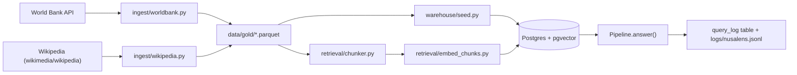
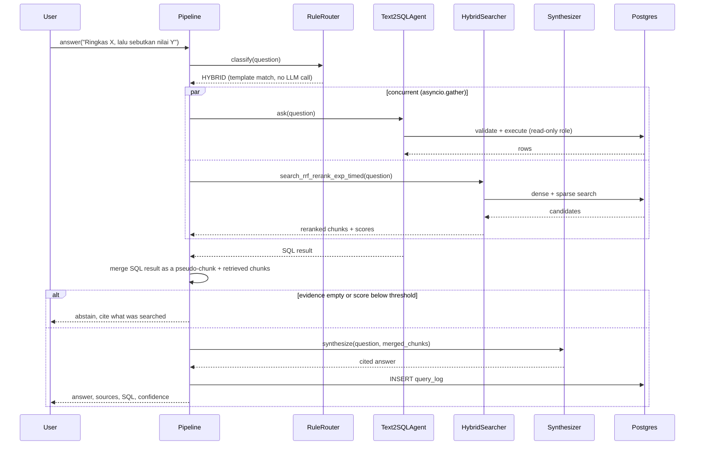

# Architecture

## Components

| Component | File | Role |
|---|---|---|
| Rule router | `src/nusalens/agents/router.py` | Classifies a question as SQL, DOC, HYBRID, or ABSTAIN by regex template match, country/indicator substring lookup, and year-range check, before any LLM call. Falls back to an LLM classifier only when no rule fires. |
| Text-to-SQL agent | `src/nusalens/agents/text2sql.py`, `sql_guard.py`, `entity_resolution.py` | Resolves free-text country/indicator mentions to canonical values, generates SQL, validates it (AST parse, keyword denylist, `EXPLAIN` cost check, auto-`LIMIT`), executes under a read-only Postgres role with a 5 second statement timeout, self-repairs once on a validation or execution error. |
| Hybrid retrieval | `src/nusalens/retrieval/hybrid_search.py`, `search_dense.py`, `search_sparse.py` | Dense search (pgvector HNSW) and sparse search (Postgres `tsvector`), combined with Reciprocal Rank Fusion, then reranked with a CPU cross-encoder. |
| Synthesizer | `src/nusalens/agents/synthesizer.py` | Turns a question plus retrieved/merged evidence into a cited Indonesian answer using a versioned prompt template. |
| Pipeline | `src/nusalens/pipeline.py` | Wires the above together: routes, runs SQL and/or retrieval (concurrently for HYBRID via `asyncio.gather`), applies the abstain gate, synthesizes, logs every call to `query_log`. |
| MCP server | `src/nusalens/mcp_server/main.py` | Exposes the system as 6 tools, 3 resources, and 2 prompts over stdio, verified against a real client (`reports/10_mcp.md`). |
| API | `src/nusalens/api/app.py` | FastAPI surface over the same `Pipeline`: `POST /ask`, `POST /search`, `POST /sql`, `GET /indicators`, `GET /health`, `GET /metrics`. |
| UI | `src/nusalens/ui/streamlit_app.py` | Streamlit UI consuming the API. |

## Data flow

## Database schema

| Table | Key columns | Role |
|---|---|---|
| `documents` | `doc_id` PK, `source`, `title`, `url`, `license`, `text` | Indexed Wikipedia articles |
| `chunks` | `chunk_id` PK, `doc_id` FK, `text`, `embedding vector(384)`, `embedding_ft vector(384)`, `tsv tsvector` | Chunked document text, dense (stock and fine-tuned) and sparse index columns |
| `dim_country` | `iso3` PK, `name_id`, `name_en`, `region` | 16 ASEAN/comparator countries |
| `dim_indicator` | `code` PK, `name_id`, `name_en`, `unit`, `topic`, `source` | 53 World Bank indicators |
| `fact_indicator` | `(iso3, indicator_code, year)` PK, `value` | 38,216 rows |
| `v_indicator_series` | view over the three tables above | `country_name, indicator_name, year, value, unit`, the only shape the text-to-SQL agent and `run_readonly_sql` query |
| `query_log` | `log_id` PK, `question`, `route`, `sql`, `retrieved_chunk_ids`, `per_stage_latency_ms jsonb`, `token_counts jsonb`, `prompt_versions jsonb`, `abstained`, `confidence`, `created_at` | One row per `Pipeline.answer()` call |
| `eval_run` | `run_id` PK, `tag`, `metrics jsonb` | One row per evaluation script run |

Full live schema with sample rows: `nusalens://schema` MCP resource, or `python -m nusalens.warehouse.schema_card`.

## Sequence: a HYBRID question

