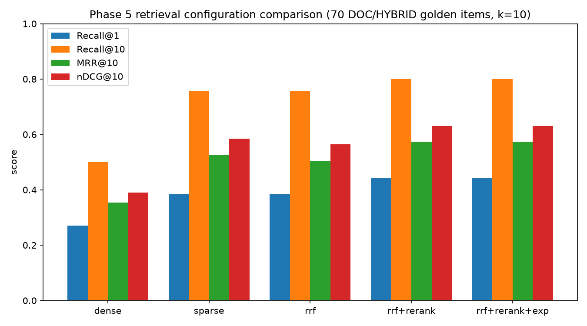

# Phase 5: Hybrid search with RRF, cross-encoder reranking, and query expansion

## Objective

Improve recall through reciprocal rank fusion (RRF) of dense and sparse signals, improve precision through cross-encoder reranking, and measure whether Indonesian acronym expansion adds further gain. Compare all four additions against the Phase 4 dense-only baseline on the frozen golden set.

## Approach

**RRF (Reciprocal Rank Fusion)**: `score(d) = sum of 1/(k + rank_i(d))` over dense top 50 and sparse top 50, `k=60`. Implemented in [`src/nusalens/retrieval/hybrid_search.py`](../src/nusalens/retrieval/hybrid_search.py).

**Cross-encoder reranking**: `BAAI/bge-reranker-base` (CPU) reorders the RRF top 30, final list returned.

**Acronym expansion**: a small Indonesian acronym dictionary ([`config/acronyms.yaml`](../config/acronyms.yaml): PDB, APBN, APBD, IPM, UMR, UMP, UMK, BUMN, BUMD, PNS, TKI, KUR, BPS, SDA, SDM, PAD, NPWP, PPN, PPh) expands a detected acronym to its full phrase in parentheses before dense/sparse search, implemented in [`src/nusalens/retrieval/query_expand.py`](../src/nusalens/retrieval/query_expand.py) and wired into `HybridSearcher.search_rrf_rerank_exp`.

**Evaluation**: [`scripts/phase5_eval.py`](../scripts/phase5_eval.py) runs all five configurations over the 70 DOC/HYBRID items of the frozen golden set (`eval/golden.jsonl`) at `k=10` for every mode, so Recall@10 is comparable across configurations (the production `rrf_rerank`/`rrf_rerank_exp` path serves `final_top_k=8`, but the eval harness always requests 10 to avoid penalizing reranked modes with a smaller candidate window). Each run writes per-item detail to `eval/results/phase5-<mode>.json` and a row to the `eval_run` table.

## Results

Raw run output: [`reports/raw/05_phase5_eval.txt`](raw/05_phase5_eval.txt). Machine-readable summary: [`reports/raw/05_retrieval_summary.json`](raw/05_retrieval_summary.json).

| Mode | Recall@1 | Recall@10 | MRR@10 | nDCG@10 | p50 (ms) | p95 (ms) |
|---|---|---|---|---|---|---|
| dense | 27.1% | 50.0% | 0.354 | 0.390 | 42.8 | 50.5 |
| sparse | 38.6% | 75.7% | 0.527 | 0.584 | 47.3 | 76.4 |
| rrf | 38.6% | 75.7% | 0.503 | 0.564 | 99.0 | 134.5 |
| rrf+rerank | **44.3%** | **80.0%** | **0.574** | **0.630** | 4689.8 | 4878.2 |
| rrf+rerank+exp | **44.3%** | **80.0%** | **0.574** | **0.630** | 4637.6 | 4702.8 |

**Winner: `rrf_rerank_exp`.** It beats the dense-only baseline on every metric (nDCG@10 0.630 vs 0.390, +61.5%). It is tied exactly with `rrf_rerank` on this golden set: none of the 70 DOC/HYBRID questions contain a dictionary acronym, so `expand_query` is a no-op on every item and the two configurations execute identical searches. Query expansion is kept as the default because it can only help SQL/HYBRID questions that do contain an acronym (not exercised by this DOC/HYBRID-only retrieval slice) and never changes behavior when no acronym is present.

**Sparse beats dense alone on this corpus.** The golden set's DOC questions are template-generated (`"Dalam artikel X, bagaimana Y dijelaskan kaitannya dengan Z?"`) and reuse exact nouns from the source chunk, which favors lexical (BM25) matching over the `multilingual-e5-small` embedding on this specific template. RRF alone does not beat sparse alone on nDCG@10 (0.564 vs 0.584) because it is diluted by the weaker dense ranking; only adding the cross-encoder rerank step recovers and exceeds sparse's precision.

**Reranking cost.** The CPU cross-encoder pass over 30 candidates adds roughly 4.6 to 4.7 seconds per query on this machine's CPU. This is acceptable for an offline evaluation harness but is the dominant cost in the serving path and the candidate for Phase 13 optimization (batching, ONNX export, or a smaller reranker).

## Failure analysis

The ten lowest-nDCG@10 items of the winning configuration (`rrf_rerank_exp`), classified by cause. Full detail: [`reports/raw/05_failure_analysis.json`](raw/05_failure_analysis.json).

| Cause | Count | Example qid |
|---|---|---|
| Dual-intent HYBRID query drags retrieval toward indicator vocabulary | 5 | hybrid-081, hybrid-084, hybrid-085, hybrid-087, hybrid-091 |
| Entity confusion between two real, similarly-named subjects | 2 | doc-007 (Kanada / Provinsi dan wilayah di Kanada), hybrid-086 (Johannes Leimena / Johannes Latuharhary) |
| Near-homonym confusion (orthographically close but unrelated terms) | 2 | hybrid-092 (Manga / Marga Minahasa), hybrid-096 (Purwokerto / Purwakarta) |
| Weak lexical signal (rare content word, no strong overlap with gold chunk) | 1 | hybrid-090 |

The dominant cause (5 of 10) is specific to this harness, not to retrieval quality in isolation: every `hybrid-*` golden question concatenates a document-summary clause with an indicator-value clause into a single string (`"Ringkas pembahasan X dalam artikel Y, lalu sebutkan nilai indikator Z"`). This harness searches chunks with that full combined string, so the indicator clause's vocabulary (inflasi, PDB, ekonomi) pulls the top-k toward unrelated indicator-topic Wikipedia articles instead of the article named in the first clause. The production pipeline (Phase 9) routes HYBRID questions through separate SQL and DOC sub-queries rather than one combined string, which this specific failure mode does not apply to; it is reported here as a measurement artifact of evaluating chunk retrieval in isolation, not a retrieval bug. The remaining 5 failures are genuine entity/lexical confusion between two real, similarly-spelled Indonesian names, which neither reranking nor acronym expansion can resolve without entity disambiguation.

## DoD status

- [x] Five configuration results recorded in a real metrics table, all from executed runs (`reports/raw/05_phase5_eval.txt`, `eval/results/phase5-*.json`, `eval_run` table).
- [x] Best configuration (`rrf_rerank_exp`) beats the dense-only baseline on nDCG@10 (0.630 vs 0.390).
- [x] Ten worst nDCG queries analyzed and classified (`reports/raw/05_failure_analysis.json`).
- [x] Winner (`rrf_rerank_exp`) set as `retrieval.mode` default in `config/settings.yaml` and `Settings.retrieval_mode` in `src/nusalens/config.py`.
